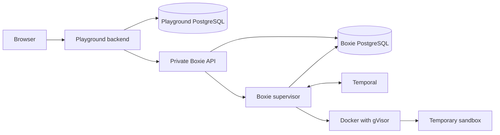

# How Sanctuary fits together

Sanctuary starts with a collection of small command-line programs. You can build
and run each one locally. Around them, the repository adds shared test tools,
benchmarks, and a browser playground that lets someone try a pull request without
installing its binaries.

The playground needs to run code from a PR safely. That is Boxie's job: it starts
short-lived sandboxes and keeps their execution separate from the public web
service. The deployment code brings those services together on a Linux host.

## Local commands and shared libraries

[buildins/](../buildins/) contains commands such as `catr`, `grepr`, and `tailr`.
Each directory is a Cargo package with one executable of the same name, its own
tests, and its own README. These are limited implementations; package docs state
where their behavior differs from familiar system tools.

[packages/](../packages) holds larger projects: Biggie generates test and
benchmark data, Kara edits text in a terminal, and Parsu parses a small XML-like
language. Boxie is also here, but it is a Python service rather than a Rust CLI.

Two libraries avoid repeating common support code. [cli-log](../utils/cli-log/README.md)
handles command logging and lifecycle records.
[cli-testing](../utils/cli-testing/README.md) starts binaries with predictable
test settings and reads fixtures without changing their bytes.

Cargo manages the Rust workspace. uv manages the Python services and tools with
a shared lockfile. Sharing a repository and lockfile does not mean the services
must be installed or released together.

## From a change to a preview

The development tools answer different questions:

| Tool | Question it answers |
| --- | --- |
| [cli-check](../tools/cli-check/README.md) | Does each CLI follow the repository's layout and documentation conventions? |
| [cli-bench](../tools/cli-bench/README.md) | How does a CLI run on a declared input compared with a reference or baseline? |
| [CLI playground](../tools/cli-playground/README.md) | What does this PR's command feel like to use? |

Behavioral tests run the real CLI and check its output and status. Benchmark
suites use Biggie to prepare inputs and hyperfine to time runs. Automatic
one-sample CI runs are smoke checks, not statistically reliable performance claims.

PR preview builds compile affected CLIs without deployment credentials. A separate
trusted publisher uploads the result and updates the PR's preview URL. Benchmark
selection requires changes to a CLI's own source or build script; preview builds
also account for affected dependencies. Neither publication nor benchmarking
releases the web service.

## What happens when a browser opens a terminal

The browser talks to the playground's Python/FastAPI backend. Its Svelte UI
shows the preview and terminal. The backend records preview revisions and browser
sessions in its own PostgreSQL database, then requests a sandbox from Boxie using
a private consumer credential. That credential stays on the server.

Boxie's API authenticates the consumer and records the request. Its supervisor
owns Docker access, uploaded artifact files, and terminal connections. A sandbox
gets the selected binaries as read-only files and a writable, disposable workspace.
It has no network and has limits on resources and lifetime. Terminal bytes travel
back through Boxie and the playground to the browser.

The services have different responsibilities. The playground decides which
preview a user is looking at. Boxie decides how to execute its artifact within
the operator's sandbox policy. The playground cannot choose arbitrary container
privileges or access the Docker socket.

## State and recovery

PostgreSQL records which consumer owns each Boxie resource, which requests have
already been accepted, and which capacity slots remain occupied. Retrying a
request must not create an extra sandbox. Stopping one does not release its slot
until container deletion is confirmed.

Temporal coordinates provisioning, cleanup, and recovery through workers inside
the supervisor. The supervisor also keeps a local execution journal and enforces
safety deadlines independently. Terminal contents are not stored in Temporal
history. An API restart can leave execution running; a supervisor restart can end
terminals.

The playground separately stores session and preview metadata, while its staging
volume holds uploads that Boxie has not yet acknowledged. Its
[persistence guide](../tools/cli-playground/docs/persistence.md) explains recovery.
Boxie's [execution guide](../packages/boxie/docs/execution.md) covers artifact
retention and uncertain container creation or deletion.

## Deployment and operations

The [shared-host deployment](../infra/environments/single-host/README.md) uses
Pulumi for a Hetzner server, disk, DNS, and operator access. Docker Compose runs
the services. GitHub Actions performs setup and manual releases over pinned SSH.
Boxie and the playground have separate release workflows; PostgreSQL and Temporal
upgrades remain explicit maintenance operations.

The intended public entry point is the playground. Boxie and its dependencies
stay on private networks. Operators reach Grafana and Temporal UI through
Cloudflare Access. Logs flow through journald and Vector to VictoriaLogs;
Prometheus collects metrics. Request IDs help connect events across services.
The [threat model](thread-model.md) records boundaries and deployment assumptions
that need verification on the actual host.

## Where to make a change

Change a command inside its owning package, including its tests and benchmarks.
Put shared CLI support in `utils/`. Browser behavior belongs to the playground;
sandbox execution and isolation belong to Boxie. Host provisioning and the
composition of those services belong to `infra/`.

Start with that component's README. It provides the usage path and links to the
more detailed contract or operating guide when you need it.
