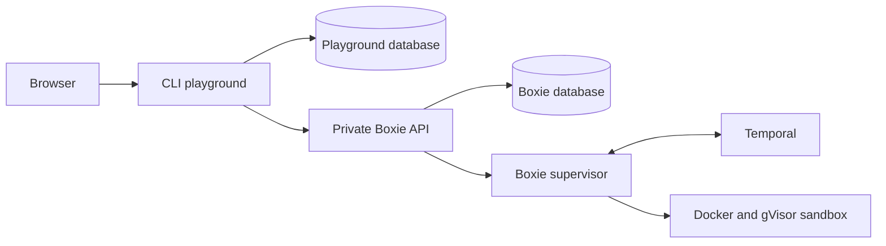

# Sanctuary architecture

Sanctuary's current implementation combines standalone commands, a sandbox runtime,
and an internal browser playground. The [platform direction](platform-direction.md)
describes how these components will support durable shell sandboxes. This page
covers the system that exists today.

## Components and boundaries

| Component | Responsibility |
| --- | --- |
| [Builtins and applications](../README.md#commands) | Standalone commands and applications, with usage and limitations in each package. |
| [Boxie](../packages/boxie/README.md) | Private consumer API, sandbox execution, isolation, and lifecycle recovery. |
| [Shish](../packages/shish/README.md) | Local shell execution through Brush, with sh/POSIX settings by default. |
| [CLI playground](../tools/cli-playground/README.md) | PR previews, browser terminals, and preview/session metadata. |
| [Shared libraries](../README.md#shared-libraries) | Logging and CLI test support. |
| [Development tools](../README.md#development-tools) | Package checks, benchmark execution, and preview workflows. |
| [Infrastructure](../infra/README.md) | Host provisioning and composition of independently operated services. |

Cargo manages Rust packages and uv manages Python services and tools. Commands
can run locally without Boxie or the playground. A shared repository and lockfile
do not require all services to be released together.

## Current execution path

The playground chooses a preview and asks Boxie to execute its uploaded artifact.
Boxie owns execution policy and isolation; the playground receives neither Docker
access nor supervisor credentials. Each service owns its application state.
Temporal coordinates runtime work, while the supervisor owns physical execution
and terminal connections.

For implementation and recovery details, read [Boxie architecture](../packages/boxie/docs/architecture.md)
and [playground architecture](../tools/cli-playground/docs/architecture.md).
The [threat model](thread-model.md) records current trust boundaries.

## Deployment and development

The current [shared-host deployment](../infra/docs/architecture.md) exposes the
playground and keeps runtime dependencies private. Service releases and dependency
maintenance have separate lifecycles.

Change commands inside their owning packages, shared support under `utils/`, and
consumer behavior in the playground. Begin with the owner's README for usage,
verification, and deeper documentation. The root [project index](../README.md)
provides the entry points.
