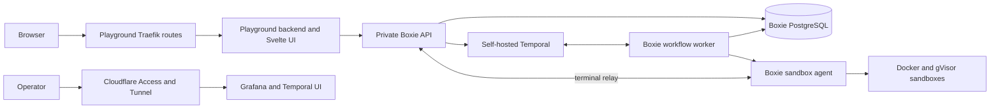

# Boxie service and CLI Playground separation

Status: conversational design agreed; written specification ready for review.

## Intent and constraints

Make the sandbox system maintainable and operable as a standalone service called
**Boxie**. CLI Playground remains its first consumer, owning the browser product
and preview infrastructure. Another internal consumer must be able to create a
sandbox without knowing about GitHub, pull requests, CLI bundles, or public domains.

Boxie is an independently deployed service, not a Python library embedded into
CLI Playground. Its internal Python modules and build metadata are implementation
details. Separate its API, lifecycle orchestration, and privileged sandbox agent
without turning every adapter into another network service or distribution.

The initial deployment uses one host. Boxie has no public endpoint: only trusted
services on private networks can connect. Temporal is self-hosted and independently
operated. Operator dashboards use Cloudflare Access. Nothing is deployed yet, so
there is no migration, legacy API, old environment-variable compatibility, or
dual-read storage requirement.

Delivery is four stacked PRs. The initial production deployment happens after
the fourth PR; intermediate PRs must still be runnable and testable. This design
supersedes the gateway coupling, compatibility, and fixed 15-minute lifetime in
the earlier playground specifications. It preserves product preview behavior
where it does not conflict with these decisions.

## Service ownership

| Component | Owns | Does not own |
| --- | --- | --- |
| CLI Playground | Svelte UI, preview identity and build status, GitHub publication, CLI selection, sample files, ELF/bundle validation, preview expiry, public routes and product access policy | Docker, Temporal workflows, generic sandbox lifecycle |
| Boxie API | Private authenticated API, generic artifacts and sandbox requests, status, terminal authorization and relay, explicit stop | GitHub, public hostnames, Docker socket |
| Boxie workflow worker | Temporal workflows, provisioning/cleanup orchestration, retry and termination policy | Browser presentation, PTY byte streaming |
| Boxie sandbox agent | Docker/gVisor provisioning adapter, actual resource inspection, PTY ownership, local cleanup enforcement | Preview metadata, public ingress |
| Temporal deployment | Upstream server, persistence configuration, schema jobs, namespace bootstrap, private operator UI origin | Boxie's application workflows |
| Observability deployment | Collection, log and metric storage, provisioned dashboards and alert rules | Terminal transcripts or product state |
| Platform deployment | Host, firewall, persistent storage, shared networks, component composition | Individual ephemeral sandboxes |

The Boxie processes form one service and release family. The sandbox agent is a
separate process/container and the only component with Docker socket access.
Sandbox creation is a cohesive agent module with a narrow internal protocol;
it is not another responsibility inside API route handlers. Temporal and
observability each have their own deployment package and lifecycle.

Keep the current Svelte SPA and a small Playground Python backend. That backend
is already the product's backend-for-frontend: it authenticates browser sessions,
resolves product policy, and proxies HTTP/WebSocket traffic to private Boxie.
Adding SvelteKit now would introduce another migration without changing the
required trust boundary.



Every arrow between services is an authenticated, explicitly permitted network
path. Browser terminal traffic always passes through Playground and the Boxie
API; neither the agent nor the Docker API is browser-accessible. API-to-Temporal
traffic submits requests, while workflow workers poll Temporal task queues.

## Modules, ports, and dependency injection

Use focused modules with dependencies pointing toward domain/application code.
Domain types must not import HTTP, Docker, Temporal, Pulumi, or Playground code.
The application layer expresses operations such as request sandbox, attach
terminal, record activity, inspect status, and terminate. Routes translate the
wire protocol; adapters translate external systems.

Suggested repository ownership:

```text
tools/boxie/
  src/boxie/
    domain/          # identifiers, states, limits, termination reasons
    application/     # use cases and semantic ports
    api/             # HTTP/WebSocket protocol and authentication
    temporal/        # workflows and activity implementations
    sandbox/         # agent protocol, PTY ownership, Docker/gVisor adapter
    persistence/     # concrete PostgreSQL and local artifact implementation
    observability/   # event schema, contextual logging, metrics
    bootstrap/       # configuration and process composition roots
  infra/             # Boxie components, configuration, manifests and smoke checks
  tests/
tools/cli-playground/
  playground/        # product application, Boxie HTTP client, preview adapters
  frontend/
  infra/             # product components, manifests, domains, routes and checks
tools/deploy/        # shared release/configuration/transport commands
infra/
  platform/          # shared host, networks, storage and persistence service
  temporal/          # independent Temporal deployment package
  observability/     # independent telemetry deployment package
  ingress/           # shared proxy/tunnel process configuration
  environments/
    single-host/     # thin Pulumi project and deployment composition
```

Each service owns its infrastructure beside its code from PR1. Its `infra/`
directory contains provisioning components, validated configuration, Compose
manifests, deployment documentation, and smoke checks. Infrastructure dependencies
stay out of runtime images. The environment composition chooses which components
to deploy and connects their inputs/outputs; it does not define service internals.
There is no second central copy of Boxie or Playground deployment configuration.
Use distinct infrastructure import namespaces, such as `boxie_infra` and
`playground_infra`, so the two directories cannot collide as a generic `infra`
module. Use normal declared dependencies rather than `sys.path` manipulation.

These directories describe ownership, not a mandate for a class or package per
file. Use ordinary constructor injection and typed protocols for meaningful
boundaries: lifecycle submission, sandbox control, terminal attachment, artifact
access, and state transactions. Each process has one composition root that builds
concrete dependencies. Avoid service locators, global mutable service objects,
framework DI, and generic repository/plugin frameworks.

Use PostgreSQL and local artifact storage now. Isolate their implementation, but
do not implement speculative storage backends, export/sending adapters, or a
public plugin API. Playground consumes Boxie over the network and must not import
its Python internals. Build and test each service with its own declared runtime
dependencies using the root uv workspace and committed lockfile; remove
`sys.path` patches and whole-workspace production installation.

## API, artifacts, and product policy

Boxie exposes create, get status, attach terminal, and terminate operations using
opaque sandbox and artifact identifiers. A create request contains an immutable
artifact reference, an approved execution profile, allowed command/environment
parameters, and bounded lifecycle limits. It carries an idempotency key scoped to
the authenticated consumer. Reusing a key with different parameters is rejected.

Execution profiles are operator-managed configuration. Consumers cannot supply
arbitrary host paths, Docker options, privileged mounts, images, or network modes.
The Playground profile supplies its approved shell, fixtures, and CLI behavior;
the Boxie core only understands the generic profile contract.

Playground validates CLI names and Linux ELF suitability before publishing a
bundle. Boxie independently validates generic archive safety, size, integrity,
and containment. Store immutable artifacts by identifier/content digest in a
private local volume; uploads cannot choose filesystem paths. Retain artifacts
while any provisioning, active, or pending-cleanup sandbox references them.
Deleting a preview or reaching its expiry requests termination through Boxie's
API. Boxie receives a reason/identifier, not a GitHub-specific lifecycle rule.

Preserve immutable revision pinning: publishing a new preview must not mutate
files used by an existing sandbox. Playground owns latest-build versus
last-runnable-build status, ordering of CI events, and the offer to switch to a
new revision. Reload or explicit reset creates a fresh session from the latest
permitted revision.

The backend owns Boxie credentials and capabilities. A page gets a separate
scoped session credential kept in page memory for the lifetime of that page.
Sandbox identifiers alone do not authorize terminal access. Enforce consumer
ownership on status, stop, artifact access, and terminal attachment. Never put
bearer capabilities in logged URLs or forward operator credentials to sandboxes.

## Durable lifecycle and Temporal

Temporal provides durable orchestration, retry, timers, and recovery of workflow
execution. It does **not** checkpoint a sandbox's filesystem or process memory,
and replay does not undo arbitrary side effects. Compensating operations must be
explicit. See [Temporal workflows](https://docs.temporal.io/workflows) and
[event history](https://docs.temporal.io/encyclopedia/event-history).

Use one workflow per sandbox. Model provisioning, ready, terminating, and terminal
outcomes explicitly; retain termination reason and cleanup status separately.
Explicit stop, timeouts, process exit, and provisioning failures converge on the
same idempotent cleanup path. A failed cleanup remains visible and retryable;
it does not silently free capacity or release an artifact reference.

PostgreSQL stores durable API requests, consumer/idempotency identity, resource
ownership, capacity reservations, artifact references, and a queryable status
projection. Temporal history owns orchestration progress; Docker inspection
establishes which resources actually exist. Do not create two independent state
machines that can each decide a sandbox is ready or deleted.

Commit accepted requests and an outbox record atomically. A dispatcher submits
them to a stable workflow ID and retries safely if submission/acknowledgment is
interrupted. Status distinguishes accepted from provisioning and ready. Stop
requests are durable too, including a stop that arrives before workflow startup.
If the outbox backlog or a required dependency exceeds readiness limits, reject
new work explicitly instead of accepting an unbounded queue.

Capacity reservations cover the full resource lifetime, including uncertain
creation and pending deletion. Provisioning uses deterministic resource identity,
Boxie ownership labels, and generation checks. Activities use ensure/inspect/delete
semantics: a timeout or retry must discover an already-created resource rather
than create a duplicate. Cleanup of an older generation cannot target a newer
sandbox. Transient errors have bounded attempts/timeouts and backoff; invalid
requests fail without retry. Temporal's [Python failure handling guidance](https://docs.temporal.io/develop/python/best-practices/error-handling)
informs these contracts.

PTY ownership and terminal output belong to the agent, outside short-lived
provisioning activities and browser sockets. The agent attaches before starting
the container and keeps draining output even when the browser disconnects.
Workflow code never streams terminal bytes through Temporal history.

On restart, reconcile only resources owned by this Boxie installation. Remove the
current delete-all-on-start behavior. Preserve resources only when ownership,
generation, and deadlines can be established; otherwise terminate them through
the recorded cleanup path. API or workflow-worker restarts must not automatically
destroy healthy agent-owned sandboxes. An agent/host restart may end terminals;
preserving their process state or restoring them is outside this scope.

The agent also enforces absolute deadlines and a bounded control-plane lease
locally, so a Temporal outage alone does not permit unlimited sandbox lifetime.
Renewal cannot move the absolute deadline. Deadline/lease data must survive agent
restart or be recovered before a surviving resource is allowed to continue. Use
a monotonic clock for live timers and persisted absolute timestamps for restart
reconciliation. Cleanup tolerates repeated requests and missing containers.

Deadline enforcement requires a functioning agent and Docker control path. If
either is unavailable, record termination as pending, retain the reservation and
artifact references, expose the failure, and reconcile immediately when control
returns. Do not claim a stopped container or guaranteed cleanup deadline during
an arbitrary host/control-path failure. Restart policies reduce that window;
they do not provide high availability.

### Agreed termination defaults

| Condition | Default | What extends it? |
| --- | --- | --- |
| Absolute sandbox lifetime | **60 minutes** from accepted creation | Nothing; active use and reconnect do not extend it |
| Inactivity | **10 minutes** after ready or last accepted terminal input | Deliberate terminal input |
| Disconnected terminal | **2 minutes** after disconnection is detected | Successful authorized reattachment to the same session |
| Explicit stop or reset | Immediate termination request | Nothing |

The earliest applicable deadline wins. If no terminal attaches, the disconnect
grace starts when the sandbox becomes ready. Transport heartbeats, metadata
polling, window resizing, and command output do not count as user activity. A
long command with no further input can therefore hit the inactivity limit; this
is an interactive playground policy, not a noninteractive job guarantee.

Use one validated policy contract across the API, workflow, and agent. Replace
the existing shell's independent 900-second kill so it cannot terminate a session
before the agreed policy. Display the absolute expiry and an explicit termination
reason in Playground. Operator-configured maxima constrain consumer overrides.
Bound and coalesce activity updates; do not emit a Temporal event per keystroke.

The agent owns live input/attachment timestamps and serializes renewal against
expiry decisions. An idle/disconnect termination request carries the observed
generation and is conditional on that deadline still being expired. A stale
timer cannot kill a renewed attachment; the workflow records the agent's result
and reschedules. Explicit stop and absolute expiry are unconditional. This keeps
coalesced activity reports from racing valid input or reconnect at a deadline.

Retain the current initial sandbox constraints: non-root user, gVisor, read-only
root filesystem, no network, dropped capabilities, no-new-privileges, 512 MiB RAM,
one CPU, 256 PIDs, and bounded temporary filesystems/output. Start with eight
concurrent sandboxes. Measure host capacity with the complete Temporal/logging
stack before declaring the selected VM suitable; do not equate sandbox limits
with reserved host headroom.

### Same-page reconnect only

Support a temporary network disconnect while the **same page remains open**.
Keep its existing xterm instance and scoped session identity. If the sandbox is
still alive and the disconnect grace has not elapsed, reattach to its existing
PTY. Files and running processes remain because the sandbox was never stopped.

Use a bounded in-memory output replay buffer in the agent, sequence cursors, and
acknowledgment after output is applied by xterm. Resume from the browser's last
applied sequence retained in page memory, not the server's last received ACK.
Serialize pending xterm writes across reconnect, ignore duplicate sequences, and
switch atomically from replay to live delivery. Never replay terminal input.
Fence concurrent connections so only the current attachment can write or update
activity. If output has fallen out of the buffer, report a terminal-stream gap
and offer a fresh session instead of silently presenting an incorrect terminal.
Keep replay bytes out of telemetry.

Freeze xterm geometry while disconnected and replaying. Apply replay at the last
synchronized geometry, then synchronize the latest browser dimensions with the
PTY before resuming input. This avoids replaying cursor movement against a
different terminal width after a resize while offline.

**Page reload recovery is excluded.** Reload creates a new session; the old one
expires under its disconnect policy. Do not add browser persistence, terminal
screen snapshots, filesystem checkpoints, or recovery after agent/host failure.
The reconnect guarantee ends when the old PTY or output continuity is lost.

## Self-hosted Temporal and persistence

Ship an independent Temporal deployment package using the upstream production
server image, pinned versions, explicit schema-management jobs, and idempotent
namespace bootstrap. Do not deploy a development server or implicitly upgrade
schemas on every Boxie start. Follow the [self-hosted deployment guidance](https://docs.temporal.io/self-hosted-guide/deployment)
and [server upgrade procedure](https://docs.temporal.io/self-hosted-guide/upgrade-server).

Start with one PostgreSQL instance and separate databases/credentials for Boxie,
Temporal persistence, and Temporal visibility. Separate their migration ownership
and release ordering. PostgreSQL visibility avoids another search cluster; see
[Temporal PostgreSQL visibility](https://docs.temporal.io/self-hosted-guide/visibility/postgresql).
Persistent volumes are managed independently from application releases and are
never removed by a routine Compose update/down command.

Temporal services remain private. Use dedicated-CA mutual TLS to admit only
trusted Boxie, Temporal internal/UI, and operator clients, with server hostname
verification. The initial upstream server's no-op API authorizer means every
admitted client is a fully trusted cluster administrator; do not claim per-user
or namespace RBAC. The namespace is organizational. This explicit transport
admission boundary protects the initial single trust domain; private networking
alone and default authorization do not. Consult
[Temporal security guidance](https://docs.temporal.io/self-hosted-guide/security).
Expose only its operator UI through the protected dashboard ingress. Use a
shared task queue for the initial single-host worker pool, with explicit host
ownership in agent requests. Do not build multi-host placement now.

Workflow changes must be replay-compatible with active histories. Add replay
coverage and drain/version workers deliberately when a change cannot be made
compatible. This is correctness for ongoing workflows, not legacy compatibility
with the old undeployed gateway. Schema changes remain explicit release steps.

The repository pins Python 3.15. Before the main PR1 extraction, run a disposable
Temporal SDK installation/import/worker feasibility check on that interpreter.
PR2 adds committed CI coverage for workflow replay, cancellation, and worker
restart. A published wheel alone does not prove support. If this gate fails,
report the specific blocker before choosing a different interpreter or SDK
version; do not silently downgrade the whole workspace. This preflight adds no
fifth PR or supported production mode without Temporal.

## Operational visibility

Emit JSON logs to stdout using stdlib logging integrated with structlog, including
Uvicorn and unhandled errors. Set context at request, workflow/activity, and agent
boundaries. Useful fields include service, process role, release, event name,
severity, timestamp, request ID, sandbox ID, workflow/run ID, activity attempt,
termination reason, duration, and exception details. Use context propagation
explicitly across processes; see [structlog integration](https://www.structlog.org/en/stable/standard-library.html)
and [context variables](https://www.structlog.org/en/stable/contextvars.html).
Use Temporal's replay-aware workflow logger/metric facilities so replay does not
emit duplicate operational lifecycle events.

Operational logs never contain terminal input/output, artifact bodies, cookies,
authorization headers, or capability tokens. High-cardinality IDs are searchable
fields, not stream labels or metric dimensions. Redact at emission and test it.
Keep sensitive values out of Temporal arguments, results, failure details,
search attributes, and propagated context as well. Pass opaque references for
agent-resolved sensitive configuration; do not serialize raw credentials inside
command/environment workflow parameters. Test persisted workflow history and
logs with sentinel secrets. See [Temporal data handling](https://docs.temporal.io/dataconversion).

Use journald for long-lived service logs, Vector for collection, VictoriaLogs for
storage, and Grafana for provisioned dashboards. Retain searchable VictoriaLogs
data for seven days. Journal copies use shorter retention; journal storage and
Vector buffers have separate bounded disk budgets defined in deployment
configuration. The seven-day window describes searchable storage, not guaranteed
delivery of buffered logs. Do not mount Docker's socket into the collector or
tail the private binary files of Docker's local
logging driver. Sandboxes keep their logging driver disabled; the agent owns their
PTY output. See [Docker journald](https://docs.docker.com/engine/logging/drivers/journald/),
[Vector journald](https://vector.dev/docs/reference/configuration/sources/journald/),
and [VictoriaLogs ingestion](https://docs.victoriametrics.com/victorialogs/data-ingestion/vector/).

Collection failure must not block provisioning or terminal I/O. Bound memory and
disk use at the producer, container logging driver, journal, and collector; use
nonblocking delivery and explicitly allow diagnostic drops under sustained
overload. Make loss/backpressure visible and test a stalled/full journal, not
only a collector outage. A retention age alone is not a hard disk quota; monitor
storage headroom as well. Keep local emergency access to service logs if the
dashboard is unavailable. See [Docker delivery modes](https://docs.docker.com/engine/logging/configure/#configure-the-delivery-mode-of-log-messages-from-container-to-log-driver).

Include a small Prometheus deployment for service/host metrics and alert rules;
Grafana queries it alongside VictoriaLogs. Configure both time and size retention
with headroom for its write-ahead log and compaction; see [Prometheus storage](https://prometheus.io/docs/prometheus/latest/storage/).
Track active/reserved capacity,
provisioning latency/failures, dependency readiness, workflow/task-queue health,
cleanup age/backlog, agent leases, disk pressure, and telemetry drops. Dashboards
must support finding a failed request, following its sandbox lifecycle, and
distinguishing workflow retries from duplicate resources. Alert rules cover
overdue cleanup, exhausted capacity, unavailable workers, and low disk space.
No external notification integration or custom Boxie dashboard is required now.

Grafana and Temporal UI are private operator tools accessed through Cloudflare
Access and Tunnel. Validate Access at the tunnel/origin boundary and prevent
direct-origin bypass. Only approved dashboard routes use that ingress; Boxie's
API remains internal. See [Cloudflare self-hosted Access applications](https://developers.cloudflare.com/cloudflare-one/access-controls/applications/http-apps/self-hosted-public-app/)
and [VictoriaLogs Grafana integration](https://docs.victoriametrics.com/victorialogs/integrations/grafana/).

## Pulumi, releases, and CI

Keep the initial Pulumi project under `infra/environments/single-host`, with an
environment per stack. It is a thin composition root over service-owned
infrastructure and the independently owned shared components. Boxie's provisioning
components live in `tools/boxie/infra`; Playground's live in
`tools/cli-playground/infra`. Shared host, networking, storage, and persistence
definitions live in `infra/platform`. Pulumi owns cloud resources,
host/bootstrap identity, firewall rules, persistent disks, and configured DNS.
It never provisions individual sandboxes. The existing remote Pulumi
state-backend approach remains separate from application backups. See
[Pulumi components](https://www.pulumi.com/docs/iac/concepts/components/) and
[project/stack organization](https://www.pulumi.com/docs/iac/guides/basics/organizing-projects-stacks/).

Keep resource declaration separate from workload activation. Service-owned
Pulumi components declare service-specific cloud resources and configuration;
Compose manifests describe workloads activated by the release tool. Pulumi must
not manage the same containers that the release tool reconciles.

Infrastructure follows the same dependency direction as the services. The
environment passes explicit host/network/storage handles, private service
endpoints, approved image identities, and secret references. Boxie infrastructure
does not import Playground infrastructure or create Temporal implicitly.
Playground infrastructure receives Boxie's private endpoint and consumer
credential reference without importing Boxie's resource implementation. Temporal
and observability remain independent infrastructure packages that the environment
selects and wires. Shared component contracts stay small and typed.

One host and one Pulumi state boundary are initial deployment choices, not code
ownership boundaries. Separate application releases already operate independently.
A future environment can compose Boxie without Playground or place them on
different hosts using the same components. Splitting Pulumi projects/state later
still requires an explicit resource-ownership transfer; directory separation alone
does not perform that transfer or solve remote artifact/storage access.

Application releases use explicit manifests and separate Compose units for
platform persistence, Temporal, observability, Boxie, shared ingress, and
Playground.
Assign shared networks, volumes, and proxy process configuration one owner.
Service manifests and product routes remain in their owning `infra/` directories;
core services must start without a Playground domain or Traefik configuration.
The environment layer only selects components, supplies configuration, and orders
startup. It must not turn a targeted application release into a global Compose
update. Shared release tooling must not grow Boxie/Playground-specific branches
or become a second home for their deployment logic.

Platform ingress owns the dashboard tunnel, Access configuration, and operator
DNS. Playground owns its product hostname and public routes. One release manifest
versions Boxie's API, workflow worker, and agent together. Independently released
components declare their dependency/schema compatibility; an application release
never reconciles shared resources owned by another component.

Provisioning and release are distinct commands. Ordinary Playground releases
must not run Pulumi, require cloud provisioning credentials, or restart Boxie,
Temporal, PostgreSQL, or observability. Ordinary Boxie releases must not upgrade
Temporal's schema or redeploy Playground. Configuration validates required
dependencies and secrets per component instead of requiring every product secret
for every operation.

Provisioning produces a deployment connection profile containing host address
and pinned SSH host key. Store its deployment SSH credential separately in the
deployment environment's secret store. Component releases consume this profile
without Pulumi state-decryption or cloud-provisioning credentials. The initial
host deployment credential is still administrative access; targeting one Compose
unit does not make that SSH credential unprivileged. Generated connection
manifests contain only nonsecret values and secret references; credentials are
resolved or injected at their consuming process.

Split deployment code into configuration/manifest parsing, release preparation,
SSH transport, activation, health verification, and cleanup. CI remains thin
orchestration over those commands. Keep preview build provenance, publication
ordering, and GitHub interactions inside Playground modules; those are not a
generic release tool's responsibilities. Preserve the existing separation of
untrusted PR builds from trusted publication and privileged setup jobs.

Fresh installation order:

1. Provision host, firewall, storage, and configured DNS with Pulumi.
2. Establish shared networks/volumes and PostgreSQL; run component schema jobs.
3. Start Temporal, observability, and shared dashboard ingress; verify their
   dependencies and Access protection.
4. Start Boxie; verify readiness and a generic sandbox create/terminal/stop cycle.
5. Optionally deploy Playground and its public routes; verify the product flow.

Use immutable release/image identities, bounded SSH/health deadlines that fit
inside CI timeouts, and readiness that verifies the intended release and required
dependencies. Retain the previous application release for an explicit failed
activation rollback where schemas permit it. Do not blindly roll back Temporal
schemas or claim terminal/process restoration during deployment. Agent updates
drain existing sessions or explicitly terminate them; no seamless PTY handover
is promised. A failed release must not delete persistent state.

One host is a failure domain, not high availability. Use persistent volumes,
restart policies, ownership checks, graceful shutdown, and a fresh-install
runbook now. Full off-host backup and disaster recovery are deferred.

## Four stacked PRs

Each PR targets its predecessor: `master <- PR1 <- PR2 <- PR3 <- PR4`. Keep the
design and implementation work in this stack rather than adding a fifth design
PR. Each stage updates its documentation and runs affected checks.

| PR | Title | Reviewable result and acceptance |
| --- | --- | --- |
| 1 | ♻️ Separate Boxie from CLI Playground | Extract independently runnable Boxie API/agent and generic contracts; inject adapters; keep product policy in Playground; replace direct imports with HTTP/WebSocket client. Establish each service's own `infra/` directory and deployment contract now. A generic consumer can create/attach/stop without PR/SHA/domain fields. Existing Playground E2E behavior works across the service boundary. |
| 2 | ✨ Add durable Boxie lifecycle with Temporal | Add independent Temporal/PostgreSQL deployment, workflow worker, outbox, reservations, idempotent agent operations, deadlines, cleanup/reconciliation, and same-page reconnect. Retries and worker restarts do not duplicate resources; timeout/disconnect/stop behavior is verified. |
| 3 | ✨ Add Boxie operational visibility | Add JSON event/correlation schema, collector, VictoriaLogs, Prometheus, Grafana, Access-protected operator routes, dashboards and alert rules. A deliberately failed lifecycle can be diagnosed without terminal contents entering logs. |
| 4 | ♻️ Compose deployment and harden operations | Wire the service-owned infrastructure into the thin single-host Pulumi environment, finish shared platform components and split CI responsibilities, validate release identity/deadlines, verify fresh installation and independent updates/failure handling, finish operator runbooks and security/resource checks. No migration or full backup system. |

PR1 may retain a minimal direct lifecycle implementation behind the new service
boundary to keep the extraction runnable. PR2 replaces it; the final system does
not maintain a second production mode without Temporal. Infrastructure ownership
and service-local deployment contracts are established in PR1; Temporal and
observability arrive with their own infrastructure packages in PR2 and PR3.
PR4 integrates and hardens the production environment rather than postponing
separation or all runnable infrastructure until the end.

## Verification and completion criteria

Use E2E tests for actual contracts and failure boundaries, with focused unit tests
only where they add distinct value. Keep current useful tests while moving them
to their owning component; do not rewrite everything to mirror new classes.

- Service isolation: build/install Boxie independently; reject imports from
  Playground; exercise a non-Playground consumer with a generic artifact/profile.
- Product flow: publish a bundle, open a terminal through the backend, publish a
  new immutable revision without mutating the live sandbox, reset, and expire it.
- Lifecycle: timeout after Docker create but before acknowledgment, duplicate
  requests, stop during provisioning, worker/API restart, failed deletion,
  reservation contention, and delayed/out-of-order activity updates.
- Expiry: active use still ends at 60 minutes; input renews only the 10-minute
  inactivity timer; heartbeat/output renew neither; disconnect ends after two
  minutes; reconnect never moves the absolute deadline. Use controlled clocks.
- Terminal: same-page reconnection during output, duplicate/stale attachments,
  lost acknowledgments, pending xterm writes, resize while offline, buffer overflow,
  no replayed input, and page reload creating a new session while the abandoned
  one expires. Include input/reattachment racing an idle/disconnect timeout.
- Failure containment: Temporal unavailable, outbox dispatch interrupted, agent
  lost, host restart with surviving metadata, orphan resources, and collector
  outage. Prove bounded failure detection and cleanup when the agent/Docker are
  available, and truthful pending-cleanup status otherwise.
- Security: private API/agent/Temporal network reachability, consumer ownership,
  archive containment, approved profiles, no credential leakage, and dashboard
  Access/origin bypass prevention.
- Deployment: Pulumi component tests/preview, manifest/config validation, failed
  activation, independent component updates, fresh installation, and Linux/gVisor
  smoke covering resource isolation. Local tests do not prove real DNS/Access.
- Infrastructure isolation: validate Boxie's deployment without Playground
  configuration, validate Playground against supplied Boxie connection outputs,
  and test environment wiring separately from each component's implementation.

Run the root Ruff, strict mypy, and pytest checks for changed Python tools; include
new service and infrastructure paths in the shared configuration. Run frontend
checks/browser tests, workflow syntax/security checks, and Markdown checks where
affected. Follow the repository's CLI testing policy if Rust CLI fixtures change.
Benchmarks remain PR-only and scoped to affected suites; a one-sample smoke run
does not establish a performance improvement.

## Explicitly deferred

- [Noninteractive job execution: issue #37](https://github.com/di-rs/clis/issues/37).
  No job API or stdout/stderr result storage in the initial four PRs.
- [Off-host backups and tested restore: issue #38](https://github.com/di-rs/clis/issues/38).
  Persistent volumes and restart safety do not claim protection from host loss.
- Page reload restoration, terminal snapshots, sandbox checkpoint/restore,
  filesystem rollback, and seamless agent/host restart continuity.
- Multi-host scheduling, high availability, autoscaling, public Boxie access,
  alternate storage/export adapters, a custom operator UI, and SvelteKit migration.

No additional product decisions are required before implementation planning.
Exact wire schemas, dependency versions, replay-buffer bounds, and deployment
settings must be made concrete and tested in the implementation plan within the
constraints above; Python/Temporal support remains an explicit feasibility gate.
