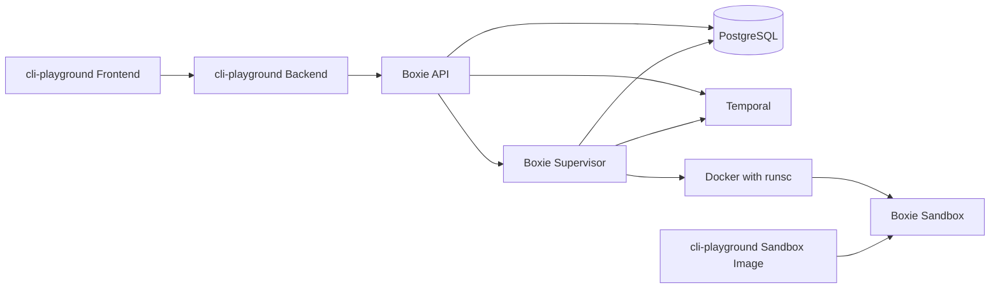

# Consistent component names across Sanctuary

Contributors and operators should be able to follow one component from its
documentation to its source, configuration, deployment and logs without learning
another name for it. Sanctuary currently uses names such as platform, gateway,
playground, runtime and orchestrator for overlapping responsibilities. This
change gives each responsibility one name and updates its references together.

The vocabulary below is agreed. This change covers naming and the migration of
renamed identifiers. Product implementation has not started.

## Scope and follow-up

Keep this change focused on consistent naming. Preserve the current consumer API
fields, profile behavior, artifact layout, startup behavior and packaging
ownership while renaming their references. The current application-owned sandbox
image remains under cli-playground for this change.

[Issue #70: Boxie-owned default environment](https://github.com/di-rs/sanctuary/issues/70)
tracks the next architecture step: Boxie supplies the environment and consumers
provide only files. That issue owns the API simplification, new file-bundle
layout, environment and startup ownership, release separation and associated
artifact migration. None of those changes or their implementation checks belong
to this naming change. Complete the naming cleanup first; plan and implement the
default environment separately.

## Component vocabulary

| Name | Responsibility | Identifier convention |
| --- | --- | --- |
| Sanctuary | The repository and system as a whole, including shared infrastructure | `sanctuary`, `SANCTUARY_*` |
| cli-playground | The application for trying CLIs | `cli-playground`, `cli_playground`, `CLI_PLAYGROUND_*` |
| cli-playground Frontend | Browser UI and terminal interaction | `cli-playground-frontend`; `frontend` inside its application directory |
| cli-playground Backend | Preview management, artifacts, sessions and access to Boxie | `cli-playground-backend`; `backend` inside its application context |
| Boxie | The sandbox execution service as a whole | `boxie`, `BOXIE_*` |
| Boxie API | Consumer authentication, sandbox admission and access | `boxie-api`, `boxie.api`, `BOXIE_API_*` |
| Boxie Supervisor | Privileged sandbox execution, recovery, cleanup and terminals | `boxie-supervisor`, `Supervisor`, `BOXIE_SUPERVISOR_*` |
| Boxie Sandbox | One isolated execution environment managed by Boxie | `Sandbox`, `sandbox_id`, `/v1/sandboxes` within Boxie |
| cli-playground Sandbox Image | Current application-owned shell and tools, retained until issue #70 | `cli-playground-sandbox`, `CLI_PLAYGROUND_SANDBOX_IMAGE` |

Use Frontend and Backend in documentation and full words in identifiers. FE and
BE are acceptable conversational abbreviations. Use cli-playground consistently,
including in headings. Boxie and Sanctuary retain their capitalization in prose.
Within an unambiguous namespace, short role names such as `api`, `supervisor` and
`backend` are sufficient; do not prefix every local variable with a product name.

Boxie is independently usable by consumers other than cli-playground. A Boxie
Sandbox is the resource it manages. Docker and gVisor's runsc supply the current
execution and isolation machinery, and retain their own names. The application
owns its sandbox image and approved profile; Boxie owns sandbox execution.

## Boundaries and behavior

The component names describe the existing responsibilities in the
[Boxie service composition](https://github.com/di-rs/sanctuary/blob/2ecb7e3e94c68824018427d8615d79265826d614/packages/boxie/infra/compose.yml)
and [cli-playground application](https://github.com/di-rs/sanctuary/blob/2ecb7e3e94c68824018427d8615d79265826d614/tools/cli-playground/src/playground/app.py):

The Backend serves the built Frontend assets today. This rename does not create a
separate frontend server or split the Python distribution. The Boxie API remains
unprivileged; only the Supervisor receives Docker access. Temporal workers stay
embedded in the Supervisor. PostgreSQL continues to own admission, capacity and
artifact references. Terminal framing, authorization and resource limits retain
their existing behavior.

Keep API as the name of Boxie's consumer service: its authentication and durable
request handling are more specific than the name gateway. Use Supervisor for the
service that owns execution on a host. Orchestration describes work done through
Temporal, rather than naming another component.

## Rename scope

Update owned names across source, imports, package metadata, configuration,
commands, tests, fixtures, build outputs, CI, deployment, observability and
documentation. Preserve the existing package boundaries and directory layout
except where the name itself is obsolete.

| Existing name or surface | Target |
| --- | --- |
| `platform` for shared setup or its GitHub environment | `sanctuary` |
| `cli-playground-setup.yml`, `cli-playground-infra-check.yml` for shared infrastructure | `sanctuary-setup.yml`, `sanctuary-infra-check.yml` |
| `playground` Python package and imports | `cli_playground` |
| `playground-infra`, `playground_infra` | `cli-playground-infra`, `cli_playground_infra` |
| `PlaygroundService` and other application-prefixed symbols | `CliPlaygroundService` and `CliPlayground*` |
| `@sanctuary/playground` | `@sanctuary/cli-playground-frontend` |
| `PLAYGROUND_*` | `CLI_PLAYGROUND_*`; use `CLI_PLAYGROUND_BACKEND_IMAGE` for the backend image |
| `gateway` Compose service and release selector | `backend` within cli-playground; `cli-playground-backend` in shared selectors |
| `playground-gateway` image/component | `cli-playground-backend` |
| `playground-sandbox` image/component | `cli-playground-sandbox` |
| GitHub environments `playground`, `playground-preview` | `cli-playground`, `cli-playground-preview` |
| `playground` consumer/profile IDs and application-owned resource names | `cli-playground` and `cli-playground-*` |
| `/opt/sanctuary/playground`, `playground.env`, `playground-image.env` | `/opt/sanctuary/cli-playground`, `cli-playground.env`, `cli-playground-image.env` |
| `/opt/playground` inside the sandbox image | `/opt/cli-playground` |
| `boxie-orchestrator`, `orchestrator` service role | `boxie-supervisor`, `supervisor` |
| `Orchestrator*`, `orchestrator_*`, corresponding module and configuration names | `Supervisor*`, `supervisor_*` |
| `BOXIE_RUNTIME_IMAGE` | `BOXIE_IMAGE` |
| Boxie's `Runtime.Dockerfile` | `Boxie.Dockerfile` |
| cli-playground's `Playground.Dockerfile` | `Backend.Dockerfile` |
| `build-runtime-image.yml` | `build-image.yml` |
| `bootstrap/runtime.py` containing embedded workers | `bootstrap/workers.py` |
| API bootstrap `RuntimeConfig` | `ApiProcessConfig` |
| `ExecutionRuntime` and its module | `SandboxExecution` in `execution/sandbox.py` |
| `LogRuntime` and logging runtime accessors | `LogDispatcher` and corresponding dispatcher accessors |
| Observability `runtime.py` | `process.py`, describing process-scoped monitoring |
| Boxie's `infra/runtime.md` | `infra/host-requirements.md` |

Regenerate lockfiles through their package managers after metadata changes.
Update static asset packaging, frontend build paths and installed-package import
checks with the Python module rename. Workflow display names must still begin
with an emoji. Rename workflow triggers, trusted publisher identity checks,
artifact references, job dependencies and status-check configuration together.

Other Sanctuary packages keep their own names. Generic domain concepts such as
preview, session, artifact, profile, lifecycle, proxy and worker remain useful
when they describe their actual responsibility. Review remaining uses of runtime
and gateway by meaning; do not mechanically replace them with Boxie or Sanctuary.
Third-party syntax such as Docker's `Runtime`, Pulumi's `runtime`, runsc's
`--platform`, Python's `RuntimeError` and operating-system platform checks stays
unchanged.

## Existing installations and stored state

Use a coordinated maintenance cutover. Fresh installations use only the new
names. Existing installations must keep their data, ownership identities and
credentials through migration. Do not assume installations are disposable.

Before migration, stop new admission and preview publication, let active
sandboxes finish, confirm cleanup, then stop writers and back up configuration,
PostgreSQL, execution journals and application data. A failed precondition stops
the cutover before changing state. Never run the old and renamed Supervisor
against the same data directory at the same time.

The [existing database schema](https://github.com/di-rs/sanctuary/blob/2ecb7e3e94c68824018427d8615d79265826d614/packages/boxie/alembic/versions/0001_lifecycle.py)
contains orchestrator table and column names. Rename them to supervisor through a
new Alembic migration. Convert stored termination reasons, including
`orchestrator_restart` and `orchestrator_shutdown`, to their supervisor forms.
The [execution journal](https://github.com/di-rs/sanctuary/blob/2ecb7e3e94c68824018427d8615d79265826d614/packages/boxie/src/boxie/sandbox/execution/journal.py)
also stores those reasons. Its offline conversion must produce records readable
by the renamed models. Changing the cli-playground consumer/profile names must
preserve artifact ownership, preview references and idempotency associations
across SQL, journals and application metadata. Preserve installation UUIDs,
host IDs, sandbox IDs and artifact IDs. Detect conflicting old and new entries
rather than overwriting one.

Keep existing Temporal workflow IDs and task queues where they already express
Boxie lifecycle responsibilities. Preserve replay compatibility with recorded
histories. Historical migration files and immutable workflow or log histories
may contain old names; do not rewrite them to satisfy a text search. Isolate any
necessary legacy decoding at the migration or history boundary, with tests.

Move application-owned host paths and configuration together. Recreate renamed
stateless services and networks only after checking their consumers. Copy data
to newly named Docker volumes during the maintenance window, verify the copy,
and retain the originals for rollback. Preserve secret bytes and private file
permissions. Coordinate renamed certificate identities with Temporal access
configuration. Do not recreate infrastructure resources just because their
logical Pulumi names changed; preserve resource identity through aliases or
explicit state migration where needed.

GitHub environment protection rules, variables, secrets, image permissions and
required checks require an operator cutover alongside the repository changes.
The implementation must provide a concrete inventory and migration procedure;
renaming a workflow reference alone does not transfer those settings. Live
account changes and deployment are separate from preparing the repository patch.

Once the new services can load existing state, serve previews and create and
clean up a sandbox, resume admission and publication. If validation fails, stop
the new services and restore the matching old images, configuration and backed-up
state before reopening traffic. Never run old code against partially migrated
state. Retain backups until the cutover is accepted.

Old configuration names and import paths will not remain as general-purpose
aliases. Necessary legacy strings belong only in explicit migrations, historical
fixtures, immutable histories and this before/after specification. New writes,
configuration examples and operational output use the canonical vocabulary.

## Verification and completion

The implementation must satisfy these checks:

1. Search tracked paths and content for the obsolete component names and review
   every remaining match against the exceptions above, including case variants.
2. Run Python lint, formatting, strict typing and regression tests, including
   installation rendering, release scripts, preview publishing and observability.
3. Build and test the Frontend; build both Python distributions and import them
   outside the checkout. Verify installed static assets and resolved Compose
   configuration use the new names.
4. Test migration using representative old SQL, journal and application records.
   Verify ownership, artifact access, retained previews and termination reasons;
   reject conflicts and demonstrate retry or rollback after partial failure.
5. Run PostgreSQL/Temporal recovery and history replay tests. Run the native
   Linux/runsc browser and lifecycle E2Es to verify sandbox execution, terminal
   reconnection, Supervisor restart and cleanup with the renamed components.
6. Check workflow syntax/security, documentation links and spelling. Verify
   deployment environment and required-check mappings before activation.

Use the repository's [testing guide](../../testing.md) and applicable repository
rules for exact commands. Report missing native prerequisites separately; mocked
Docker tests cannot establish Linux/runsc behavior. This rename makes no
performance claim and does not change unrelated CLI behavior.

The completed change has one operational vocabulary, matching code and docs,
passing affected checks, and a tested upgrade path. The only surviving old names
are explicitly justified compatibility or historical records.
