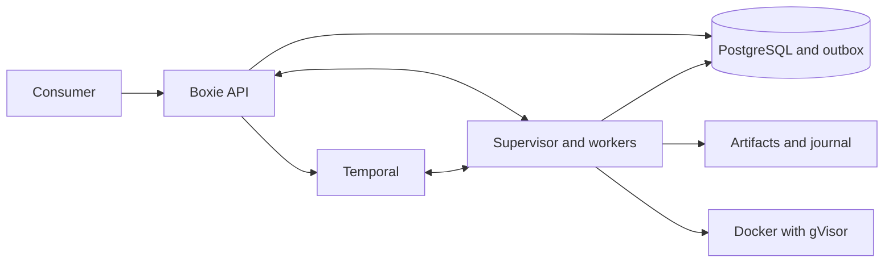

# Boxie architecture

Boxie is Sanctuary's sandbox runtime. It separates request acceptance from physical
execution so API retries and process failures do not lose track of owned resources.
The [consumer API](consumer-api.md) is its integration boundary; the playground is
one caller, not a runtime dependency.

## Request and execution ownership

The API authenticates consumers and commits admission, ownership, and capacity to
PostgreSQL. A durable outbox bridges that transaction to Temporal. The supervisor
embeds the workflow workers and alone owns Docker access, artifact files, and PTY
connections. Its local journal records execution intent before container creation.

SQL records accepted ownership and accounting; the supervisor reconciles those
records with physical resources. Uncertain creation or deletion keeps capacity
and artifact references reserved. Local deadlines keep enforcing safety during
dependency outages. [Execution and recovery](execution.md) owns the detailed
lifecycle contract, limits, and maintenance behavior.

## Durability boundary

Temporal survives worker retries, but terminal processes are not durable shell
workflows. Restarting the supervisor ends PTYs. Today's sandbox runs Bash with
operator-owned profiles. Shish runs locally but is not yet packaged into Boxie's
approved profiles. The [integration design](../../shish/docs/durability.md)
evaluates that step and future durable jobs separately; it changes no runtime
guarantee. See [platform direction](../../../docs/platform-direction.md) for priorities.

Database migrations and retention belong to [database operations](database.md).
Temporal server maintenance is a [separate operating task](temporal.md), independent
of ordinary Boxie releases. [Deployment](deployment.md) covers installation and
[observability](observability.md) covers diagnostics.

## Source organization

The consumer API and supervisor transport share explicit wire contracts under
`boxie/contracts/`; cli-playground keeps its own consumer models and has no Boxie
runtime dependency. `application/ports.py` defines the interfaces consumed by the
API. Routes receive those interfaces directly.

The supervisor implementation is grouped by responsibility:

- `sandbox/execution/`: coordination, one execution owner per sandbox, journal,
  provisioning, physical reconciliation and retention.
- `sandbox/terminal/`: PTY reader, bounded replay and WebSocket session delivery.
- `sandbox/transport/`: authenticated supervisor client/server and terminal relay.
- `bootstrap/`: configuration loading, dependency construction, readiness probes
  and background service startup/shutdown.

Each `SandboxExecution` owns its locks, deadlines, tasks, terminal and session
references. Persisted `ExecutionRecord` values retain the journal format.
A terminal session pins its execution until WebSocket delivery and closing finish;
retention requires settled local work, a saved removal confirmation and the
control-plane receipt before removing the record and execution together.

Network adapters validate incoming terminal controls once and return typed events
to relays, which serialize them for the next connection.
