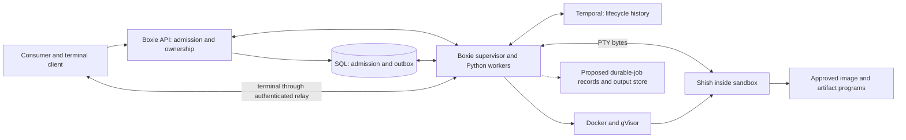

# Shish, Boxie, and durable execution

Shish currently runs locally; Boxie's shipped sandbox uses Bash. This proposal
would run shish as an operator-approved program inside Boxie's existing sandbox
lifecycle, keeping Temporal connectivity in Boxie. Durable jobs would require
explicit submission and a declared recovery policy; ordinary terminal commands
would not become durable automatically.

## Existing boundary and first integration

Boxie's [consumer API](../../boxie/docs/consumer-api.md) admits an artifact under
authenticated ownership and capacity limits. The operator selects the image,
command, environment, and limits through a versioned
[profile](../../boxie/src/boxie/sandbox/profiles.py); consumers cannot substitute
an arbitrary image, command, or host path. The supervisor owns Docker access,
terminal transport, and Temporal workers. The
[execution contract](../../boxie/docs/execution.md) defines provisioning,
reconciliation, deadlines, and cleanup.

The first implementation would package shish and its required external utilities
in a digest-pinned image, admit an absolute shish command through an approved
profile, and exercise the existing PTY transport. Preserve the non-root user,
read-only root/artifacts, disabled network, gVisor runtime, and resource limits.
Current `/workspace` and `/tmp` are ephemeral tmpfs mounts with `noexec`; putting
an executable there will not make it runnable. Put approved binaries in the
image or admitted artifact location instead.

Solid connections represent existing Boxie mechanisms, with shish as the proposed
sandbox program. The dotted job store is future work. Temporal receives lifecycle
identifiers and nonsecret facts; terminal bytes take the supervisor relay path.

## What recovery means

Reattachment reconnects a client to a surviving process. Restart reruns work from
a defined initial state. Resume continues from an application-defined checkpoint.
These have different requirements and must have different acceptance tests.

| Failure | Current Boxie guarantee | Proposed shish integration | Durable-job requirement before claiming more |
| --- | --- | --- | --- |
| Browser or network disconnect | Reattach while execution survives and deadlines allow it; replay is bounded and can report a stream gap. | Same process and in-memory shell state may remain available; no replay of terminal input. | Separate job lifetime from attachment policy only through an explicit admitted policy. Persist output if replay beyond the current buffer is required. |
| API restart | Supervisor may continue execution; committed SQL admission/outbox survive if their storage survives. | Reconnect through the restored API within existing limits. | Keep job identity, owner, and result lookup independent of the HTTP connection. |
| Supervisor restart | PTYs end; ownership journals and SQL fences support cleanup/reconciliation, not session restoration. | Do not promise restoration of shell variables, foreground commands, or terminal state. | Reconcile the previous attempt before any replacement; classify unknown results and preserve resource reservations. |
| Sandbox process/container loss | Lifecycle cleanup can converge; a lost process is not restored. | Files in tmpfs, shell memory, job table, and command progress are lost. | Restart only from durable declared inputs, or use a separately supported checkpoint protocol. |
| Host loss | Local artifacts, journals, and running processes may be unavailable; no cross-host process recovery is promised. | No automatic migration or resumption. | Off-host durable storage, owner fencing, orphan reconciliation, image availability, and a tested host replacement policy. |
| Temporal outage | Boxie retains committed commands and enforces local deadlines; new admission is subject to readiness rules. | Shell execution does not gain a bypass around those limits. | Reconcile submitted intent and completion after recovery; never infer execution absence from a timeout. |
| Completion acknowledgement lost | Lifecycle operations reconcile physical facts. | A command may have changed files or external systems before its result was lost. | Record an uncertain outcome; query an authoritative receipt or require an explicit retry decision. |

The terminal protocol provides
[sequenced output replay](../../boxie/docs/consumer-api.md#connect-a-terminal), not
screen snapshots, persisted stdin, or process memory. Replay after a supervisor
restart is not promised. A lifecycle workflow finishing cleanup says nothing
about whether a shell command completed successfully.

## Explicit durable jobs

Prefer runtime-mediated submission: a trusted Boxie worker owns the job lifecycle
and runs the admitted workload inside a sandbox. The shell is a workload frontend,
not a Temporal worker. Submission still needs a reviewed product/API contract;
this document does not invent or expose an endpoint.

| Design | Benefit | Cost and decision |
| --- | --- | --- |
| Boxie-mediated jobs | Reuses admission, ownership, profile snapshots, SQL fences, supervisor isolation, and existing Python SDK workers. | Add explicit job/attempt state and durable input/output contracts. Recommended starting point. |
| Workers embedded in shish or each sandbox | Can expose shell-specific operations directly as activities. | Requires sandbox access to control credentials/network, worker routing and versioning, and recovery after worker/sandbox loss. Conflicts with the current trust boundary; reject as the initial design. |
| Detached process manager or terminal multiplexer | Useful for client disconnects while a host and process survive. | Does not provide host-loss recovery, side-effect reconciliation, or checkpointing. May complement terminal UX, not replace durable jobs. |
| Application checkpoints | Can resume supported long-running programs from durable progress. | Each program needs checkpoint validation and restore semantics. Do not infer support for arbitrary commands or pipelines. |
| Process/container checkpointing | Could preserve selected process state. | Requires a separate feasibility study for gVisor, kernel/runtime compatibility, open files, sockets, and restored credentials. No current support claim. |

[Temporal replay](https://docs.temporal.io/workflow-execution#replays) reconstructs
workflow decisions from recorded events. It does not capture a subprocess's
memory, file descriptors, or shell AST evaluation position. Run external effects
in activities controlled by the supervisor, with workflows coordinating identifiers
and decisions. [Activity execution](https://docs.temporal.io/activity-execution)
can retry work; the activity must reconcile an attempt instead of blindly launching
a second process.

### Identity, ownership, and immutable inputs

A durable submission needs an owner-scoped job ID and idempotency key, with a
canonical immutable specification. Changed specifications under the same key
must conflict. Each execution attempt needs its own ID, sandbox generation,
owner/host fence, start intent, observed start, and completion receipt. A workflow
run ID alone is not a command identity or evidence that a process started once.

The specification must pin image digest, shish/Brush version, mode, artifact
hashes, working directory, arguments, approved environment version, locale,
resource limits, and retry policy. Secret references need explicit version and
rotation rules without persisting the secret in workflow data. Recovery cannot
silently use a different image, mutable `PATH`, or current shell environment.
Do not snapshot a live interactive shell implicitly; require declared inputs.

### State that must persist

| State | Current behavior | Proposed durable-job contract |
| --- | --- | --- |
| Files | Image/artifacts are read-only; writable tmpfs disappears with execution. | Versioned input manifests and durable output publication with checksums, ownership, retention, and atomic commit rules. Partial output remains marked incomplete. |
| Variables and cwd | Brush holds shell state in process memory. | Explicit initial environment and cwd. No implicit restoration of shell variables, functions, aliases, options, or open descriptors. |
| Output | Bounded terminal replay in the live supervisor. | Separate bounded durable stdout/stderr objects with ordered offsets and terminal result metadata. Account for partial writes and duplicate delivery. |
| Progress | Process memory and external side effects. | An application checkpoint/receipt reference with schema/version and integrity checks, when that job type supports one. Heartbeats alone are liveness observations. |
| Completion | A caller can lose acknowledgement. | Persist attempt identity, exit status or signal, result manifest, and publication receipt before acknowledging success. |

Neither command history nor terminal transcripts are a safe job specification.
Replaying `printf x >> file` may append twice. Exporting variables also misses
shell functions, current directories, file offsets, background processes, and
remote effects.

### Retries, cancellation, and deadlines

Default arbitrary commands to **no automatic execution retry after an uncertain
start or completion**. Classify attempts as not started, running, succeeded,
failed, cancelled with confirmation, or outcome unknown. A timeout is not proof
that the process stopped. Keep accounting and ownership until physical absence
or an authoritative completion receipt is established.

A retry is eligible only when absence of execution is proven, the operation has
an enforceable idempotency contract, or the submitter explicitly accepts duplicate
side effects. A key in SQL does not make an external command idempotent. External
systems need their own deduplication receipts; compensation is a separate action,
not evidence that an effect never happened.

Cancellation records desired stop durably, fences new starts, signals the owned
process group, escalates within a bound, and confirms cleanup. Preserve an
absolute deadline across attempts; a retry must not reset it. Keep resource,
output, idle, attachment, and job deadlines distinct. Workflow cancellation is
not a substitute for signalling and observing processes. Temporal's
[Python error handling](https://docs.temporal.io/develop/python/best-practices/error-handling)
provides retry/failure controls; product-specific retry eligibility remains ours.

### Credentials and sensitive data

Keep Temporal certificates, Docker access, SQL credentials, and consumer/control
credentials outside the sandbox. Boxie's current
[Temporal deployment](../../boxie/docs/temporal.md#trust-and-private-transport)
treats admitted mTLS clients as fully trusted administrators; a namespace is not
an authorization boundary.

Persist only approved opaque IDs and bounded nonsecret facts in workflow inputs,
results, signals, heartbeats, errors, memo, and search attributes. Resolve sensitive
specifications inside trusted activities from an access-controlled store. Keep
terminal input/output, command text containing secrets, environment values, and
checkpoint contents out of history, logs, and metrics. Redact failures before
crossing the activity boundary. Output/checkpoint storage needs encryption,
owner authorization, retention, deletion, and size limits independently of
Temporal history retention.

## Validation before implementation

Shish integration needs a digest-pinned image, an approved profile, and Linux/gVisor
checks for non-root execution, read-only mounts, disabled networking, executable
locations, and profile rejection. PTY checks must cover sizing, signals, foreground
groups, reconnects, stream gaps, deadlines, and supervisor restart.

Durable jobs additionally require the contracts above, validated with changed-key
conflicts, owner isolation, generation fences, quotas, partial publication, and
crash consistency. Lost start/completion acknowledgements must reconcile without
duplicate launches. Test workflow replay, worker upgrades, cancellation races,
descendant cleanup, dependency outages, and deadlines across retries.

Before claiming host-loss recovery, test off-host restore, former-owner fencing,
orphan cleanup, and recreation of the pinned environment. Each checkpoint protocol
needs integrity/version checks and interrupted-publication tests for its supported
application. Release checks must include credential and sensitive-data handling,
restore drills, operator runbooks, retention, and deletion.

The design reuses Boxie's [workflow payload boundary](../../boxie/src/boxie/temporal/contracts.py)
and Python Temporal workers. No recovery experiment or production rollout is
claimed here.
