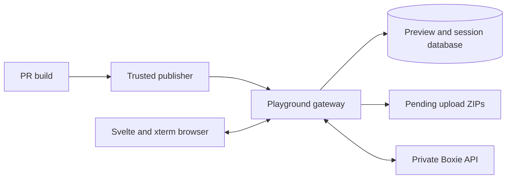

# CLI playground architecture

CLI playground is an internal consumer of Sanctuary. Today it uses Boxie's private
HTTP/WebSocket API to turn a pull request's binaries into browser terminals. It owns
preview selection and browser sessions; Boxie owns sandbox execution and isolation.
The [platform direction](../../../docs/platform-direction.md) describes the intended
consumer boundary as Sanctuary develops.

## From pull request to terminal

Untrusted PR jobs compile binaries. A separate trusted publisher uploads them and
updates the preview link. Opening that link loads the Svelte frontend and requests
a session through the Python/FastAPI gateway. Publication does not itself start a
sandbox. The gateway uses its server-side consumer credential to ask Boxie for one.

Native containers preserve the repository commands' filesystem, process, and
interactive-terminal behavior. Browser-only execution would require a different
compatibility target. The frontend renders the terminal; it does not execute the
uploaded binaries or parse shell commands.

The gateway stores metadata in its own PostgreSQL database and stages unfinished
uploads on disk. [Database and recovery](database.md) explains transactions and
reconciliation. The Boxie client uses consumer contracts without importing the
Boxie runtime. It cannot choose privileged execution settings or access Docker.

Browser reconnect behavior and terminal limits are documented in the
[README](../README.md#terminal-recovery). [Preview publication](previews.md) covers
trusted publication and credentials; [deployment](deployment.md) covers service
composition, and [observability](observability.md) covers request tracing.

## Command explorer and terminal ownership

The explorer consumes the revision catalog described in [preview publication](previews.md#build-and-comparison-contract).
Clap reflection supplies the command tree during the unprivileged build. Trusted
publication validates data and digests without invoking the executable; the gateway
persists that reference separately from Boxie's executable artifact.

`App.svelte` owns one terminal controller and the active revision. CLI selection,
search, filtering, and the mobile drawer update the explorer without replacing
the terminal DOM. Build polling records the latest available revision but cannot
switch the active workspace. Only an explicit fresh-session action remounts the
terminal and loads another catalog. Reconnection uses the existing session.

The explorer renders metadata as text. Insertion shell-quotes individual command
and flag tokens, rejects terminal control characters, and passes the text through
the terminal's existing paste path. It never sends Enter or operand placeholders.
Command details and comparison badges have no effect on terminal ownership.

## Domain, application and adapters

The synchronous [domain](../src/cli_playground/domain.py) decides whether a build
can publish and how session attachment claims change. It accepts validated values
and an explicit time, and performs no database, filesystem or network operations.
[Sandbox contracts](../src/cli_playground/sandbox.py) likewise have no transport
implementation.

The [persistence ports](../src/cli_playground/ports.py) expose async methods
returning domain values. The async [application service](../src/cli_playground/service.py)
calls them directly, for example `await self.store.get(preview_id)`. Domain code
does not receive SQL sessions or await database calls.

The PostgreSQL adapters in [storage.py](../src/cli_playground/storage.py) and
[session_store.py](../src/cli_playground/session_store.py) receive a shared async
session factory from [database.py](../src/cli_playground/database.py). Each database
operation opens and closes its own `AsyncSession` through the async `connection`
context manager. Writes use short transactions. SQL queries use the async psycopg
driver, so waiting for the database yields to the event loop. HTTP/WebSocket and
Boxie transport remain asynchronous.
